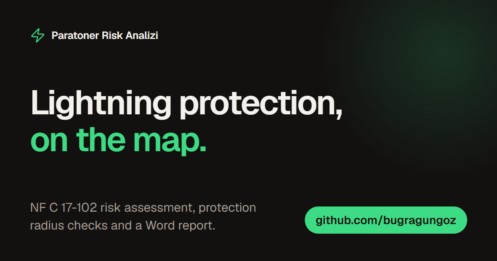
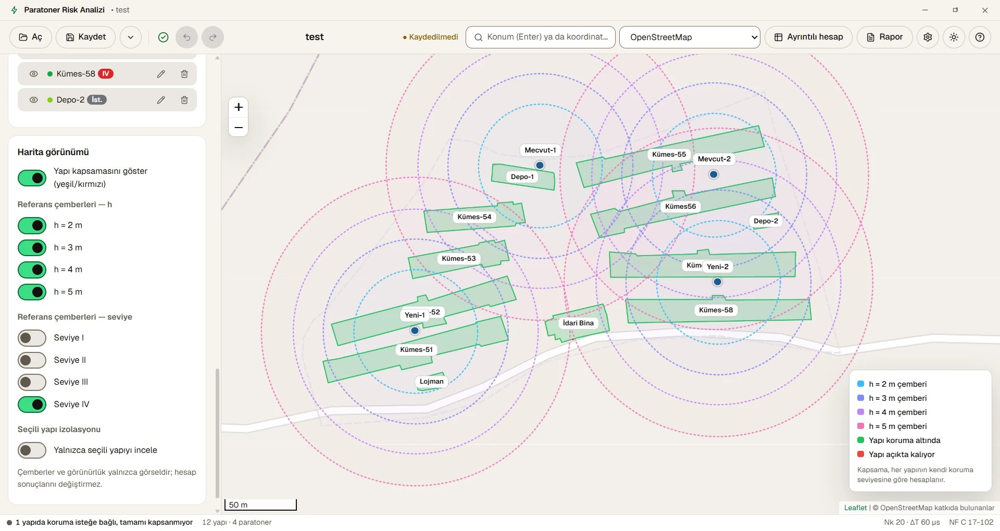
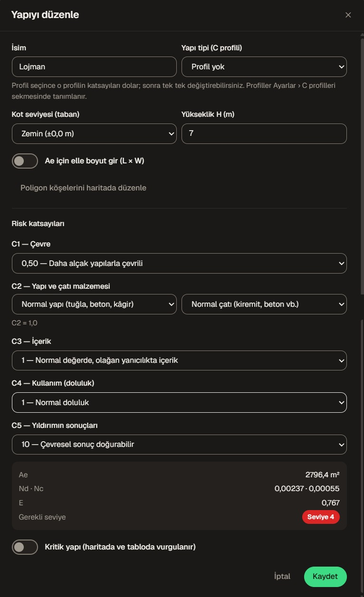
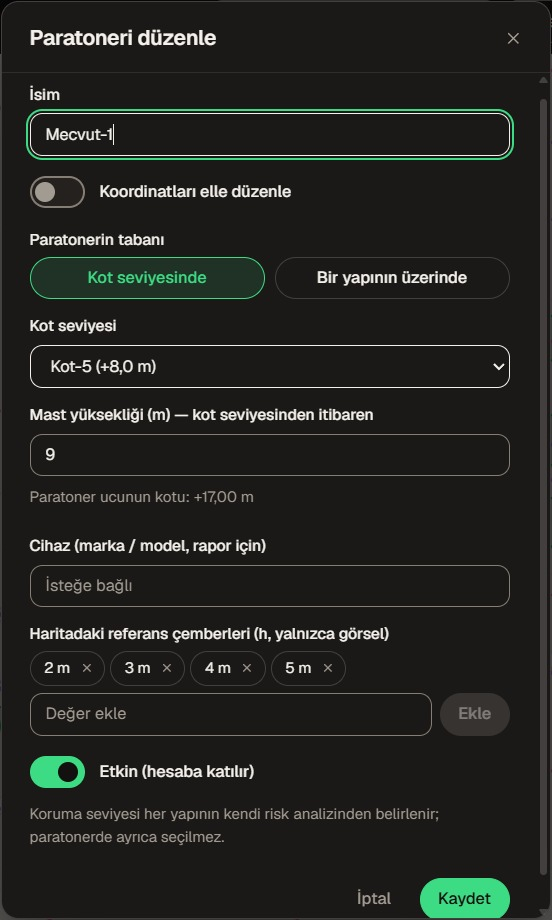
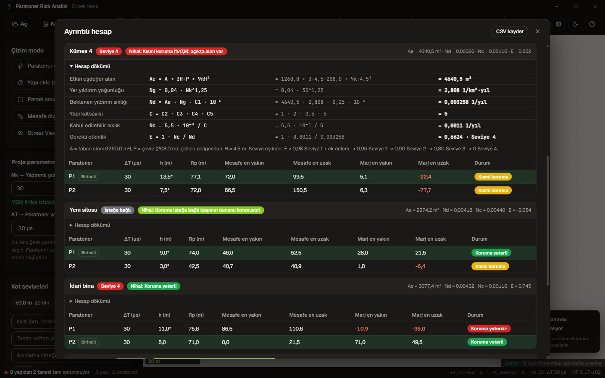

# Paratoner Risk Analizi (Lightning Risk Analysis)

A Windows desktop app for electrical engineers who design lightning protection with early streamer
emission (ESE) air terminals. You draw the site on a map; the app runs an NF C 17-102 based risk
assessment, finds the required protection level of every structure, checks with each terminal's
protection radius whether the whole structure is covered, and writes a Word or PDF report.

The interface and reports are in Turkish.

**[Download the latest release](https://github.com/bugragungoz/paratoner-risk-analizi/releases/latest)** (Windows 10/11, 64-bit).
The installer is not code-signed; if Windows SmartScreen shows a warning, continue with "More info"
and "Run anyway".

[Türkçe](README.md) · [Changelog (TR)](CHANGELOG.md) · [Security](SECURITY.md) · [License and notices](NOTICE.md)

*A poultry farm: 12 structures and 4 air terminals. Reference circles for h = 2-5 m around each terminal, the protection state of every structure, and a summary in the status bar.*

## What it does

- **Draw on the map.** Structures are placed as polygons and air terminals as points; ground
  levels, roof-mounted terminals and the plot boundary are defined.
- **Risk assessment.** The required protection level is calculated for every structure.
  Coefficients C1-C5 are picked only from the table values; coefficient profiles can be saved for
  recurring structure types.
- **Protection check.** The farthest point of every structure is compared with the terminal's
  protection radius; combined protection by several terminals is calculated separately. The result
  is shown on the map in green and red.
- **Calculation breakdown.** Every structure's calculation is shown step by step with the formula,
  the substituted values and the result, so it can be checked by hand.
- **Report.** Word and PDF: input tables, method and assumptions, per-structure assessment, scaled
  map figure.
- **Maps.** Google and Esri satellite imagery with the user's own key, OpenStreetMap without one.
  Official services only.

With missing or non-standard input the app does not calculate and says so.

| Structure and risk coefficients | Air terminal |
|---|---|
|  |  |

<b>Calculation method</b>

| Quantity | Relation |
|---|---|
| Equivalent collection area | Ae = L·W + 6H(L+W) + 9πH²; for a polygon A + 3H·P + 9πH² |
| Ground flash density | Ng = 0.04 · Td^1.25 (Td: thunderstorm days per year) |
| Expected frequency | Nd = Ae · Ng · C1 · 10⁻⁶ |
| Tolerable frequency | Nc = 5.5 · 10⁻³ / (C2 · C3 · C4 · C5) |
| Required efficiency | E = 1 − Nc / Nd |
| Protection level | E > 0.98: I with additional measures · > 0.95: I · > 0.90: II · > 0.80: III · otherwise: IV |
| Protection radius | Rp is read from the manufacturer table (ΔT = 15/30/45/60 µs) with linear interpolation between rows. Cross-check: √(2rh − h² + ΔL(2r + ΔL)), r = 20/30/45/60 m |

## Limits and assumptions

- **Method.** The risk assessment is the simplified method (Nd, Nc, E). The risk-component method
  of EN 62305-2 is out of scope.
- **Edition of the standard.** The protection radius follows the September 2011 edition of
  NF C 17-102. The simplified risk method is not in the text of that edition; its Annex A gives a
  risk-component method and suggests Ng ≈ 0.1 · Td. The app's Ng = 0.04 · Td^1.25 gives a lower Ng
  for Td ≤ 39. Follow the method required by the authority that receives the report.
- **Protection radius.** Rp is read from the table; table values are rounded to whole metres. The
  terminal tip must be at least 2 m and at most 60 m above the surface it protects; a terminal
  outside this range never counts as protecting the structure.
- **Geometry.** A structure is treated as a flat-roofed prism; antennas, chimneys and similar items
  must be included in the structure height. The check is in plan view; taller obstacles between a
  terminal and a structure are ignored.
- **Not covered.** Down conductors, earthing, separation distance, equipotential bonding and surge
  protective device selection.

## License and legal notice

Copyright (C) 2026 Buğra Güngöz. The program, including its concept, design, calculation flow, user
interface and source code, is the original work of its author and is published under the
[GNU General Public License, version 3 or later](LICENSE).

- **Use and distribution.** The program may be freely used (including for commercial work),
  studied, modified and distributed. Distributed copies keep the copyright and author notices.
  Modified versions are distributed under the same license, with their source code, and marked as
  different from the original; the program's name and logo may not be used to promote them.
- **Warranty and liability.** The program is provided "as is", without warranty of any kind. It is
  a calculation aid, not an engineering service, design approval or certificate of conformity. The
  user and the engineer who signs the design are responsible for the results, the report and every
  decision based on them. To the maximum extent permitted by applicable law, the author accepts no
  liability.
- **Third parties.** This is an independent project, not affiliated with AFNOR, any manufacturer of
  air terminals, Google, Esri or OpenStreetMap. It does not contain the text of NF C 17-102. Map
  services are used with the user's own key, under the provider's terms.

By using the program you accept these terms. Full text: [NOTICE.md](NOTICE.md) ·
Component licenses: [docs/UCUNCU_TARAF_LISANSLARI.md](docs/UCUNCU_TARAF_LISANSLARI.md)

---

Coded with Opus 5.5, developed with Fable 5.2.
