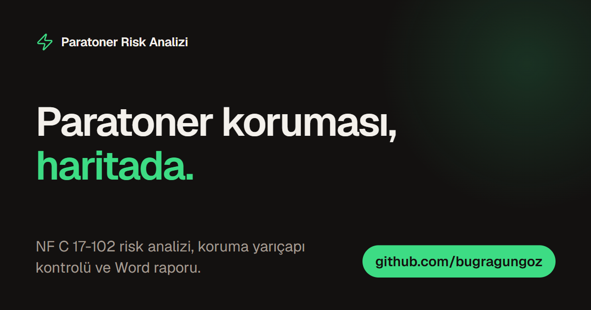
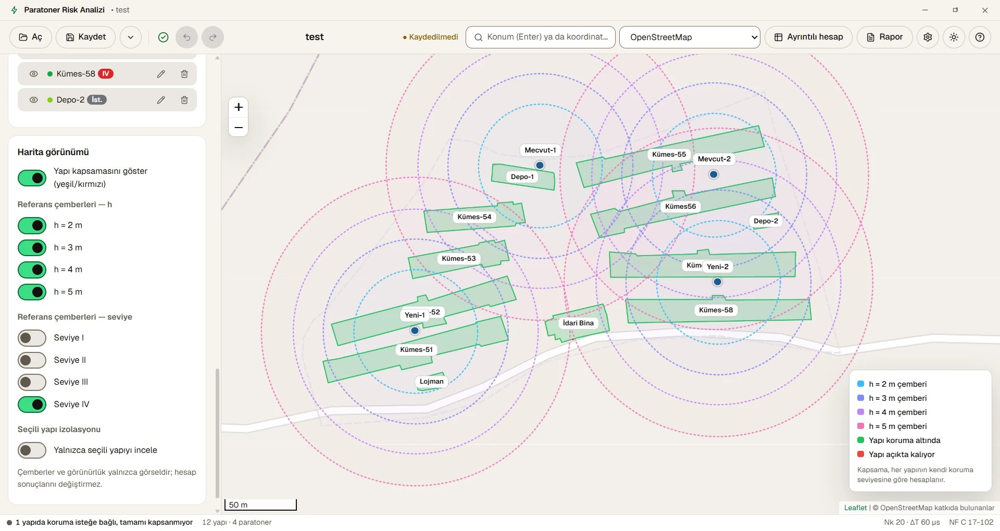
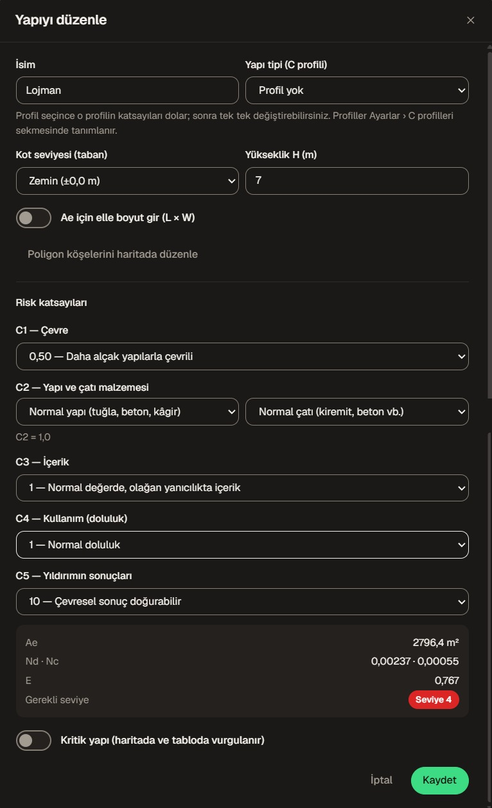
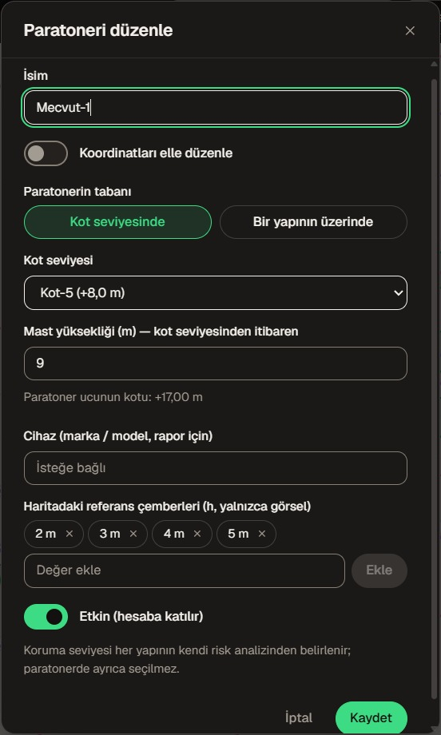
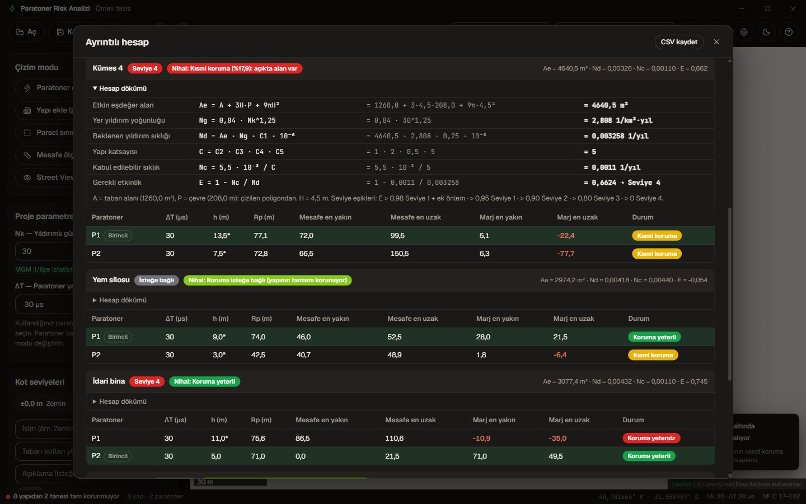

# Paratoner Risk Analizi

Aktif (ESE) paratonerli yıldırımdan korunma projesi hazırlayan elektrik mühendisleri için Windows
masaüstü uygulaması. Tesisi harita üzerinde çizersiniz; program NF C 17-102 esaslı risk analizini
yapar, her yapının gerekli koruma seviyesini bulur, paratonerlerin koruma yarıçapıyla yapının
tamamen korunup korunmadığını denetler ve Word ya da PDF raporu hazırlar.

**[Son sürümü indir](https://github.com/bugragungoz/paratoner-risk-analizi/releases/latest)** (Windows 10/11, 64 bit).
Kurulum dosyası imzalı değildir; Windows SmartScreen uyarı gösterirse "Ek bilgi" ve "Yine de
çalıştır" ile devam edilir.

[English](README.en.md) · [Değişiklik günlüğü](CHANGELOG.md) · [Güvenlik](SECURITY.md) · [Lisans ve bildirimler](NOTICE.md)

*Bir kümes tesisi: 12 yapı ve 4 paratoner. Her paratonerin çevresinde h = 2-5 m referans çemberleri, yapılarda koruma durumu, alt çubukta özet görünüyor.*

## Neler yapar

- **Haritada çizim.** Yapılar poligon, paratonerler nokta olarak yerleştirilir; kot seviyeleri,
  çatıdaki paratonerler ve parsel sınırı tanımlanır.
- **Risk analizi.** Her yapı için gerekli koruma seviyesi hesaplanır. C1-C5 katsayıları yalnızca
  tablo değerlerinden seçilir; sık kullanılan yapı türleri için katsayı profilleri kaydedilir.
- **Koruma kontrolü.** Her yapının en uzak noktası paratonerin koruma yarıçapıyla karşılaştırılır;
  birden çok paratonerin birlikte koruması ayrıca hesaplanır. Sonuç haritada yeşil ve kırmızıyla
  görünür.
- **Hesap dökümü.** Her yapının hesabı formülü, yerine konan değerleri ve sonucuyla adım adım
  gösterilir; elle denetlenebilir.
- **Rapor.** Word ve PDF: girdi tabloları, yöntem ve varsayımlar, yapı bazlı değerlendirme, ölçekli
  harita şekli.
- **Harita.** Google ve Esri uydu görüntüsü kullanıcının kendi anahtarıyla, anahtar yoksa
  OpenStreetMap. Yalnızca resmi servisler kullanılır.

Girdi eksik ya da standart dışıysa program hesap yapmaz ve "hesaplanamadı" der.

| Yapı ve risk katsayıları | Paratoner |
|---|---|
|  |  |

<b>Hesap yöntemi</b>

| Büyüklük | Bağıntı |
|---|---|
| Eşdeğer toplama alanı | Ae = L·W + 6H(L+W) + 9πH²; poligonda A + 3H·P + 9πH² |
| Yer yıldırım yoğunluğu | Ng = 0,04 · Td^1,25 (Td: yıldırımlı gün sayısı) |
| Beklenen sıklık | Nd = Ae · Ng · C1 · 10⁻⁶ |
| Kabul edilebilir sıklık | Nc = 5,5 · 10⁻³ / (C2 · C3 · C4 · C5) |
| Gerekli etkinlik | E = 1 − Nc / Nd |
| Koruma seviyesi | E > 0,98: I ve ek önlem · > 0,95: I · > 0,90: II · > 0,80: III · diğer: IV |
| Koruma yarıçapı | Rp üretici tablosundan (ΔT = 15/30/45/60 µs), satırlar arasında doğrusal ara değerle okunur. Çapraz kontrol: √(2rh − h² + ΔL(2r + ΔL)), r = 20/30/45/60 m |

## Sınırlar ve varsayımlar

- **Yöntem.** Risk değerlendirmesi basitleştirilmiş yöntemdir (Nd, Nc, E). EN 62305-2'deki risk
  bileşenli yöntem kapsam dışıdır.
- **Standardın baskısı.** Koruma yarıçapı NF C 17-102'nin Eylül 2011 baskısına göredir.
  Basitleştirilmiş risk yöntemi o baskının metninde yer almaz; Ek A risk bileşenli bir yöntem verir
  ve Ng ≈ 0,1 · Td önerir. Programdaki Ng = 0,04 · Td^1,25 bağıntısı Td ≤ 39 için daha küçük Ng
  verir. Raporun sunulacağı kurumun istediği yöntem esas alınmalıdır.
- **Koruma yarıçapı.** Rp tablodan okunur; tablo değerleri tam metreye yuvarlanmıştır. Paratoner
  ucu, koruduğu yüzeyden en az 2 m, en çok 60 m yüksekte olmalıdır; aralık dışındaki paratoner o
  yapıyı korumuş sayılmaz.
- **Geometri.** Yapı düz çatılı prizma kabul edilir; anten, baca gibi çıkıntılar yapı yüksekliğine
  dahil edilmelidir. Kontrol plan düzlemindedir; paratoner ile yapı arasındaki daha yüksek
  engeller hesaba katılmaz.
- **Kapsam dışı.** İniş iletkenleri, topraklama, ayırma mesafesi, eş potansiyel bağlama ve parafudr
  seçimi.

## Lisans ve yasal bildirim

Copyright (C) 2026 Buğra Güngöz. Program; fikri, tasarımı, hesap akışı, arayüzü ve kaynak koduyla
yazarının özgün çalışmasıdır ve [GNU Genel Kamu Lisansı sürüm 3 ya da sonrası](LICENSE) ile
yayımlanır.

- **Kullanım ve dağıtım.** Program ticari işler dahil serbestçe kullanılabilir, incelenebilir,
  değiştirilebilir ve dağıtılabilir. Dağıtılan kopyalarda telif ve yazar bildirimleri korunur.
  Değiştirilmiş sürümler aynı lisansla, kaynak koduyla ve özgün programdan farklı oldukları
  belirtilerek dağıtılır; program adı ve logosu bu sürümleri tanıtmak için kullanılamaz.
- **Garanti ve sorumluluk.** Program "olduğu gibi", hiçbir garanti verilmeden sunulur. Bir hesap
  yardımcısıdır; mühendislik hizmeti, proje onayı ya da uygunluk belgesi değildir. Sonuçlardan,
  rapordan ve bunlara dayanan kararlardan kullanıcı ve projeyi imzalayan mühendis sorumludur.
  Yazar, yürürlükteki hukukun izin verdiği en geniş ölçüde hiçbir sorumluluk kabul etmez.
- **Üçüncü taraflar.** Bağımsız bir projedir; AFNOR, paratoner üreticileri, Google, Esri ya da
  OpenStreetMap ile bağlantısı yoktur. NF C 17-102 metnini içermez. Harita servisleri kullanıcının
  kendi anahtarıyla ve sağlayıcının koşullarına göre kullanılır.

Programı kullanmak bu koşulları kabul etmek anlamına gelir. Tam metin: [NOTICE.md](NOTICE.md) ·
Bileşen lisansları: [docs/UCUNCU_TARAF_LISANSLARI.md](docs/UCUNCU_TARAF_LISANSLARI.md)

---

Opus 5.5 ile kodlandı, Fable 5.2 ile geliştirildi.
